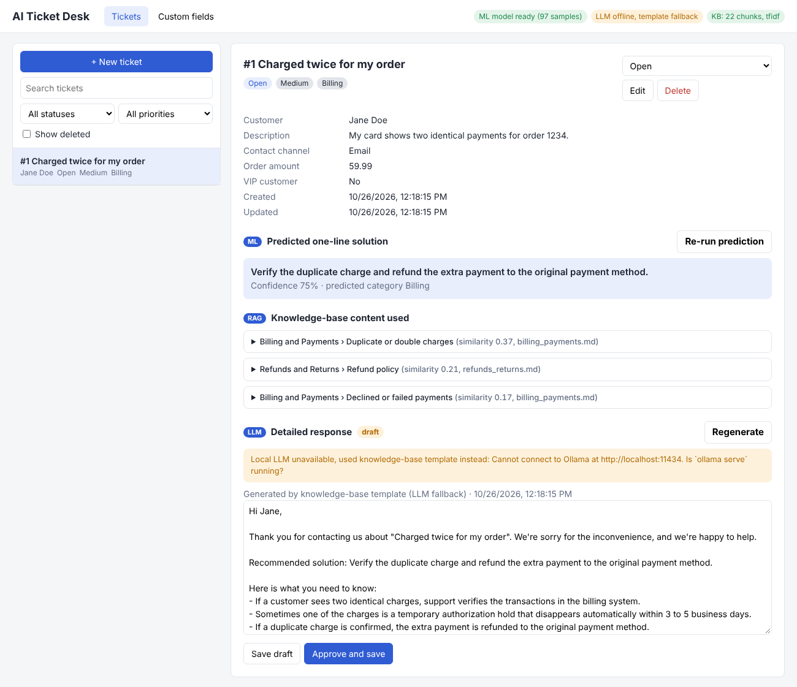
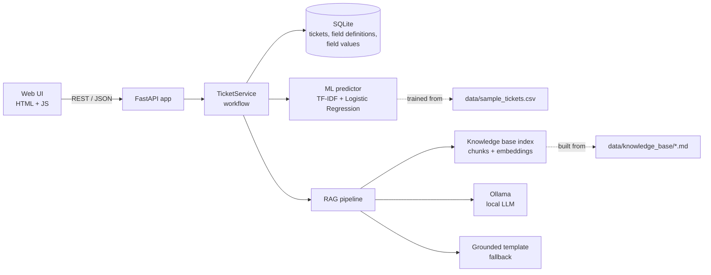
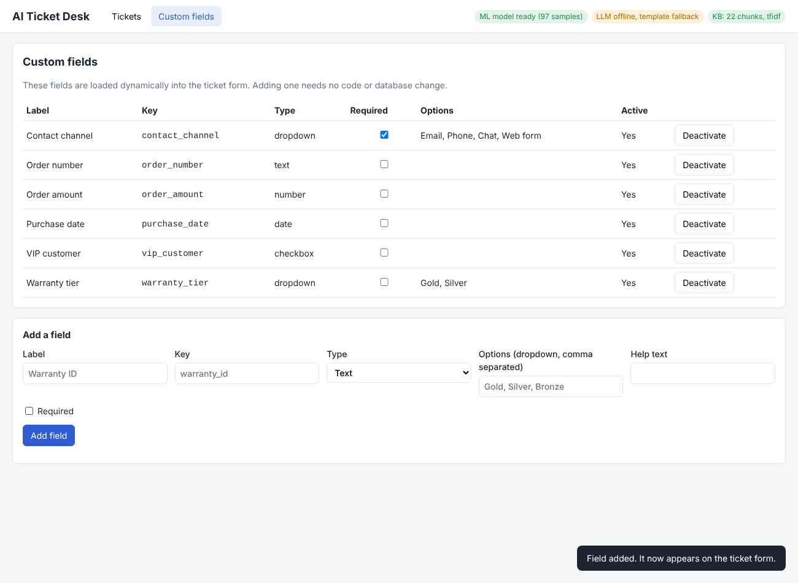

# AI Customer Ticket Response System

A web application for support agents to manage customer tickets. When a ticket is created:

1. a **local ML model** predicts a short, one-line solution, and
2. a **local LLM with Retrieval-Augmented Generation (RAG)** expands it into a detailed, customer-friendly reply that is based only on a local knowledge base.

The agent reviews and edits the reply, then saves or approves it. Everything runs on your machine; no cloud AI API is used.



---

## Contents

- [Features](#features)
- [Technology choices](#technology-choices)
- [Architecture](#architecture)
- [Installation](#installation)
- [Configuration](#configuration)
- [Running the app](#running-the-app)
- [ML prediction: how it works](#ml-prediction-how-it-works)
- [LLM + RAG workflow: how it works](#llm--rag-workflow-how-it-works)
- [Dynamic fields](#dynamic-fields)
- [Database schema](#database-schema)
- [REST API](#rest-api)
- [Testing](#testing)
- [Error handling](#error-handling)
- [Project structure](#project-structure)
- [Limitations and next steps](#limitations-and-next-steps)

---

## Features

| Requirement | Where |
|---|---|
| Ticket CRUD (create, list, view, update, status change, soft delete / restore / hard delete) | `app/tickets.py`, `app/main.py`, UI |
| ML one-line solution prediction, saved on the ticket, with confidence score | `app/ml/predictor.py` |
| ML also predicts a category when the agent leaves it empty | `app/ml/predictor.py` |
| RAG: knowledge-base retrieval with local embeddings | `app/rag/knowledge_base.py`, `app/rag/embeddings.py` |
| Local LLM (Ollama) writes the detailed response from ticket + ML solution + retrieved KB text | `app/rag/pipeline.py`, `app/rag/llm.py` |
| Grounding check that flags reply sentences or numbers not backed by the KB | `app/rag/pipeline.py` (`grounding_check`) |
| Agent review: edit, save draft, approve; the original AI draft is kept | UI + `PUT /api/tickets/{id}/response` |
| Dynamic fields (text, dropdown, number, date, checkbox) with validation, no schema change | `app/dynamic_fields.py`, Custom fields page |
| Graceful handling of missing data, ML model failure, LLM down, empty KB | see [Error handling](#error-handling) |
| 46 automated tests | `tests/` |

## Technology choices

| Layer | Choice | Why |
|---|---|---|
| Backend | **Python 3.10+ / FastAPI** | Python is where the ML tooling lives; FastAPI gives typed validation (Pydantic) and automatic API docs at `/docs`. |
| Database | **SQLite** (plain `sqlite3`) | Zero setup, a single file, enough for this use case. The SQL is standard, so moving to PostgreSQL is straightforward. |
| ML model | **scikit-learn**: TF-IDF + Logistic Regression | Small labelled dataset, short texts, fixed set of solutions: a linear text classifier is accurate, trains in under a second, and is easy to explain. |
| Embeddings | **sentence-transformers `all-MiniLM-L6-v2`** (optional), **Ollama embeddings** (optional), **TF-IDF** (built-in fallback) | All local. The app picks the best one available, so it runs even with no model downloads. |
| LLM | **Ollama** with **Llama 3.2 3B** (configurable) | Ollama is the simplest way to run open-weight LLMs locally on CPU or GPU, through a local HTTP API. A 3B model runs on an ordinary laptop. Any Ollama model can be used (`OLLAMA_MODEL`). |
| Frontend | Plain HTML, CSS and JavaScript served by FastAPI | No build step, nothing extra to install. |
| Tests | pytest + FastAPI TestClient | The LLM is replaced by a fake in tests so they run fast and without Ollama. |

## Architecture



**Request flow when an agent creates a ticket** (matches the workflow in the brief):

```
Agent submits form
  └─ 1. Validate core fields + dynamic fields            (Pydantic + dynamic_fields.validate_values)
  └─ 2. INSERT ticket and custom field values            (committed first, so the ticket is never lost)
  └─ 3. ML predicts one-line solution + category         (SolutionPredictor.predict)
  └─ 4. UPDATE ticket with predicted_solution, confidence
  └─ 5. Retrieve top-k KB chunks for ticket + solution   (KnowledgeBase.search)
  └─ 6. Local LLM writes the detailed reply              (ResponseGenerator.generate -> OllamaLLM)
        └─ on failure: grounded template from the KB chunks
  └─    UPDATE ticket with ai_response, sources, grounding report, final_response (draft)
Agent reviews / edits
  └─ 7-8. PUT /response saves final_response as draft or approved
```

In the UI, steps 1 to 4 happen in one request and step 5 to 6 in a second request, so the agent sees the ML prediction immediately and a spinner while the LLM writes.

## Installation

Requirements: **Python 3.10 or newer**. Ollama is recommended but optional.

```bash
git clone <this-repo-url>
cd ai-ticket-system

python -m venv .venv
source .venv/bin/activate          # Windows: .venv\Scripts\activate
pip install -r requirements.txt

# optional, better semantic search (downloads a ~90 MB model once):
pip install -r requirements-optional.txt
```

### Install the local LLM (Ollama)

1. Install Ollama from https://ollama.com/download (macOS, Windows, Linux).
2. Pull a model and make sure the server is running:

```bash
ollama pull llama3.2:3b        # ~2 GB. Smaller: qwen2.5:1.5b. Larger/better: llama3.1:8b
ollama serve                   # skip if the Ollama desktop app is already running
```

If Ollama is not installed or not running, the app still works: replies are built by a grounded template from the retrieved knowledge-base text, and the UI shows "LLM offline, template fallback".

## Configuration

All settings are environment variables with sensible defaults (see `.env.example`). The most useful ones:

| Variable | Default | Meaning |
|---|---|---|
| `DATABASE_PATH` | `./tickets.db` | SQLite file, created automatically |
| `OLLAMA_URL` | `http://localhost:11434` | Local Ollama server |
| `OLLAMA_MODEL` | `llama3.2:3b` | Any model you pulled with `ollama pull` |
| `LLM_ENABLED` | `true` | `false` forces template mode |
| `LLM_TIMEOUT_SECONDS` | `120` | After this the template fallback is used |
| `EMBEDDING_BACKEND` | `auto` | `auto`, `sentence-transformers`, `ollama` or `tfidf` |
| `RAG_TOP_K` / `RAG_MIN_SCORE` | `3` / `0.10` | How many KB chunks to retrieve, and the minimum similarity |
| `ML_CONFIDENCE_THRESHOLD` | `0.20` | Below this, the prediction becomes "escalate to a specialist" |
| `AUTO_GENERATE_ON_CREATE` | `true` | Run RAG + LLM as part of `POST /api/tickets` |

Example: `OLLAMA_MODEL=qwen2.5:1.5b uvicorn app.main:app`

## Running the app

```bash
# (optional) train the model and see cross-validation accuracy + sample predictions
python -m scripts.train_model

# start the app
uvicorn app.main:app --reload
```

Open **http://localhost:8000** for the UI and **http://localhost:8000/docs** for the interactive API documentation.

The database schema is created on first start, five example dynamic fields are added, and the ML model is trained automatically if `models/solution_model.joblib` does not exist yet.

To load five demo tickets through the full workflow and print the results:

```bash
python -m scripts.seed_demo
```

## ML prediction: how it works

**Task.** Map a ticket (subject + description) to one of a fixed set of approved one-line solutions. Each distinct solution in the training data is a class, so this is short-text classification. Using approved solutions as classes, instead of generating free text, means the one-liner is always a known, reviewed instruction.

**Training data.** `data/sample_tickets.csv` has 97 synthetic tickets (no real customer data) covering 18 solutions in 5 categories (Account, Billing, Shipping, Returns, Technical). Columns: `subject, description, category, priority, solution`. Add rows and run `python -m scripts.train_model` (or `POST /api/ml/retrain`) to retrain.

**Model.**

```
text = subject + subject + description          # subject repeated so it weighs more
features = TF-IDF(word 1-2 grams, English stop words removed)
         + TF-IDF(character 2-5 grams)          # robust to typos and "log in" vs "login"
classifier = LogisticRegression(C=10, class_weight="balanced")
```

Two models with this pipeline are trained: one predicts the solution, one predicts the category (used when the agent leaves the category empty). Both are saved together with joblib.

**Why this model.** With about 100 examples, deep models would overfit and be slow, while a linear model on TF-IDF features is a strong, well-understood baseline for short text. Logistic Regression also gives class probabilities, which we use as a confidence score. Training takes under a second.

**Accuracy.** Stratified 4-fold cross-validation on the sample data gives about **78% accuracy** across 18 classes (printed by `scripts/train_model.py`). Most errors are between closely related solutions, for example "refund request" and "return an item". More training rows per solution would raise this.

**Prediction.**
1. Build the text the same way as in training.
2. `predict_proba` gives a probability per solution; the highest is the prediction and its probability is the confidence. The top 3 are kept as alternatives.
3. If confidence is below `ML_CONFIDENCE_THRESHOLD`, the solution becomes *"Escalate the ticket to a support specialist for manual review."*, so a weak guess is never presented as the answer.
4. The solution, confidence and predicted category are saved on the ticket.

Example: *"Unable to log in / I forgot my password and cannot access my account."* → **"Reset the password using the account recovery process."** (confidence 0.85, category Account).

## LLM + RAG workflow: how it works

**Knowledge base.** `data/knowledge_base/*.md` holds 7 sample help-centre articles (account access, billing, subscriptions, refunds and returns, shipping, technical troubleshooting, support policy). Add or edit `.md` or `.txt` files and restart the app to re-index.

**Indexing (on startup).**
1. Each file is split into chunks at `## ` headings, so one chunk is one focused topic (22 chunks in the sample KB).
2. Each chunk ("title - section: text") is embedded with the local embedding backend and the vectors are kept in memory. The KB is small, so a NumPy matrix is enough and no vector database is needed.

**Retrieval (per ticket).**
1. Query = ticket subject + description + ML predicted solution. Including the predicted solution steers retrieval towards the right procedure.
2. Cosine similarity between the query and every chunk; keep the top `RAG_TOP_K` (3) above `RAG_MIN_SCORE`.

**Generation.** The ticket, the predicted solution and the retrieved chunks go into this prompt structure (see `app/rag/pipeline.py`):

```
SYSTEM: You are a customer support assistant ... Use ONLY the facts in the KNOWLEDGE BASE section
        and the ticket. Do not invent steps, policies, time frames, prices, links ... If the knowledge
        base does not cover the problem, say a support specialist will follow up ...
USER:   TICKET (customer, subject, description, category)
        SUGGESTED SOLUTION (from ML model)
        KNOWLEDGE BASE [1] ... [2] ... [3] ...
        Write the reply to the customer now.
```

The local LLM is called through Ollama's `/api/chat` with a low temperature (0.2) to keep it factual.

**Keeping the reply grounded.** Three layers:
1. The prompt restricts the LLM to the retrieved content and tells it to escalate if the KB does not cover the issue.
2. A grounding check compares each sentence of the reply with the retrieved text. Sentences whose content words are mostly not in the KB, or that contain numbers not in the KB (for example an invented "24 hours"), are listed in the UI under "Review" so the agent can fix them before approving.
3. The agent always reviews the draft, and the retrieved KB sections with their similarity scores are shown next to it.

**Fallback when the LLM is not available.** If Ollama is not running, the model is missing, the request times out or returns nothing, the app builds the reply from the retrieved KB sentences (rewritten from "customers should" into "you should"), wrapped in a greeting and closing. The ticket records `response_source = fallback` and the reason, and the UI shows a notice. When nothing relevant is retrieved, the reply says a specialist will follow up.

**Review and save.** The generated text is stored in `ai_response` (kept unchanged) and copied into `final_response`, which the agent edits. "Save draft" and "Approve and save" store `final_response`. Regenerating never overwrites an approved response.

**Example** for the password ticket with the sample KB:

> Input from ML: "Reset the password using the account recovery process."
> Retrieved: *Account Access and Security › Resetting a forgotten password* (similarity 0.41)
> The LLM is told to write a reply like: "Hi Jane, we're sorry you're having trouble accessing your account. Please go to the login page and select the 'Forgot Password' option ... the link is valid for 60 minutes ... check your spam folder ..." (exact wording varies by model). Without Ollama, the template fallback produces the version shown in the screenshot above.

## Dynamic fields

Field definitions are stored as rows in `field_definitions` and values in `ticket_field_values` (one row per ticket and field, value stored as JSON). The ticket form is rendered from `GET /api/fields`, so a new field appears in the form with no code or database change.

- Types: `text`, `dropdown` (with options), `number`, `date` (YYYY-MM-DD), `checkbox`.
- Validation on the server: required fields, number parsing, ISO dates, dropdown values must be one of the options, checkbox accepts true/false, unknown fields are rejected. Errors come back per field and are shown under the inputs.
- Deactivating a field hides it from the form but keeps old values.

Five sample fields are created on first start: Contact channel (required dropdown), Order number, Order amount, Purchase date, VIP customer.

Add a field in the UI (Custom fields tab) or via the API:

```bash
curl -X POST localhost:8000/api/fields -H "Content-Type: application/json" \
  -d '{"name":"warranty_tier","label":"Warranty tier","field_type":"dropdown","required":true,"options":["Gold","Silver"]}'
```



## Database schema

The full schema is in [`schema.sql`](schema.sql) and is applied automatically on startup. To create the database by hand: `sqlite3 tickets.db < schema.sql`.

```
tickets
  id, customer_name, subject, description, category, priority, status,
  predicted_solution, prediction_confidence, predicted_category, prediction_error,     -- ML
  ai_response, response_source, response_model, rag_sources (JSON),                    -- RAG + LLM
  grounding_report (JSON), generation_error, generated_at,
  final_response, response_status (none | draft | approved),                           -- agent review
  is_active, created_at, updated_at

field_definitions
  id, name (unique key), label, field_type, required, options (JSON), help_text,
  sort_order, is_active, created_at

ticket_field_values
  ticket_id -> tickets.id, field_id -> field_definitions.id, value (JSON)   PK (ticket_id, field_id)
```

## REST API

Full interactive docs at `/docs`. Summary:

| Method | Path | Purpose |
|---|---|---|
| GET | `/api/health` | Status of the ML model, LLM, and knowledge base |
| GET | `/api/tickets?status=&priority=&category=&q=&include_inactive=` | List and filter tickets |
| POST | `/api/tickets?generate=true` | Create a ticket and run ML + RAG/LLM |
| GET | `/api/tickets/{id}` | Ticket detail |
| PUT / PATCH | `/api/tickets/{id}` | Update fields, status, custom fields |
| DELETE | `/api/tickets/{id}` | Soft delete (deactivate). `?hard=true` deletes permanently |
| POST | `/api/tickets/{id}/restore` | Restore a soft-deleted ticket |
| POST | `/api/tickets/{id}/predict` | Re-run the ML prediction |
| POST | `/api/tickets/{id}/generate` | Re-run retrieval + LLM |
| PUT | `/api/tickets/{id}/response` | Save the reviewed response (`approve: true` to approve) |
| GET / POST | `/api/fields` | List / add dynamic field definitions |
| PUT / DELETE | `/api/fields/{id}` | Update / deactivate a field |
| POST | `/api/predict` | Predict a solution for any subject and description |
| POST | `/api/ml/retrain` | Retrain the model from the CSV |
| GET | `/api/kb/search?q=` | Search the knowledge base directly |

## Testing

```bash
pytest
```

46 tests, about 15 seconds, no Ollama needed (the LLM is replaced by a fake that records the prompt it receives). What they show, mapped to the brief:

| Brief requirement | Tests |
|---|---|
| Ticket CRUD works | `tests/test_tickets_crud.py` |
| ML predicts a one-line solution for different ticket types | `tests/test_ml_prediction.py` (6 ticket types, different solutions, low-confidence escalation, CV accuracy) |
| LLM expands the predicted solution | `test_llm_expands_one_line_solution_into_detailed_reply`, `test_llm_receives_ticket_solution_and_retrieved_kb` |
| KB content influences the response | `test_knowledge_base_content_changes_the_response` (same ticket, two different KBs, different replies), `test_retrieval_finds_relevant_section` |
| Response is saved, reviewed, edited | `test_response_can_be_reviewed_edited_and_approved` |
| Dynamic fields without hardcoding | `tests/test_dynamic_fields.py` (add a field via API and use it, all 5 types, validation, no schema change) |
| Missing data and model failures | `tests/test_failures.py` (missing fields, LLM down, Ollama unreachable, ML model missing or corrupt, empty KB, retrieval crash) |

To try the real LLM manually: start Ollama, run the app, create a ticket and check that the response says "Generated by local LLM (ollama:llama3.2:3b)".

## Error handling

| Situation | What happens |
|---|---|
| Missing or blank customer name / subject, invalid priority or status | 422 with a message per field; nothing is saved |
| Missing description | Allowed; the ML model works on the subject alone |
| Missing required or invalid dynamic field | 422 with errors per field, shown under the inputs |
| ML model file missing | Trained automatically from the CSV on startup |
| ML model corrupt or training data missing | App still starts; tickets are saved with `prediction_error`; `/api/health` shows the problem; `POST /api/ml/retrain` recovers |
| Low ML confidence | Solution becomes "escalate to a support specialist" |
| Ollama not running, model not pulled, timeout, empty answer | Grounded template reply from the KB, with the reason stored and shown |
| No relevant KB content | Reply says a specialist will follow up instead of guessing |
| Retrieval error | Ticket and prediction are kept; `generation_error` is stored |
| Embedding model not installed | Falls back to TF-IDF retrieval automatically |

## Project structure

```
app/
  main.py               FastAPI app, routes, startup wiring
  config.py             Settings from environment variables
  database.py           SQLite connection, schema setup, default fields
  schemas.py            Pydantic request models
  tickets.py            Ticket CRUD + workflow (save -> ML -> RAG/LLM -> review)
  dynamic_fields.py     Field definitions, validation, value storage
  ml/predictor.py       Training and prediction (TF-IDF + Logistic Regression)
  rag/embeddings.py     Local embedding backends (sentence-transformers / Ollama / TF-IDF)
  rag/knowledge_base.py Chunking and similarity search
  rag/llm.py            Ollama client
  rag/pipeline.py       Prompt, generation, grounding check, fallback
  static/               Web UI (index.html, app.js, style.css)
data/
  sample_tickets.csv    ML training data (synthetic)
  knowledge_base/       Sample KB articles (Markdown)
scripts/
  train_model.py        Train + evaluate the model
  seed_demo.py          Create demo tickets through the full workflow
tests/                  pytest suite
schema.sql              Database schema
```

## Limitations and next steps

- The training set is small and synthetic. Real historical tickets with their resolutions would improve accuracy; the model can also be retrained periodically from approved responses.
- The grounding check is lexical. A stronger option is a second local LLM pass that checks each claim against the sources.
- LLM generation is synchronous; a task queue (for example RQ or Celery) would suit many concurrent agents.
- No authentication; a real deployment would add agent login and roles.
- SQLite fits a single server; use PostgreSQL for multiple instances.

No secrets, API keys, credentials or real customer data are included in this repository.
